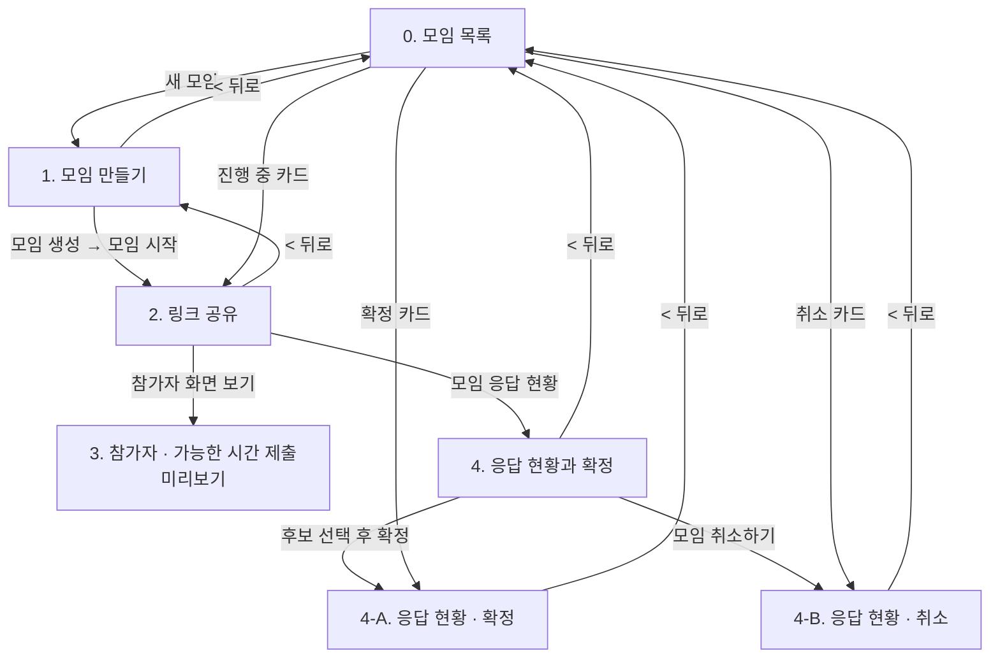
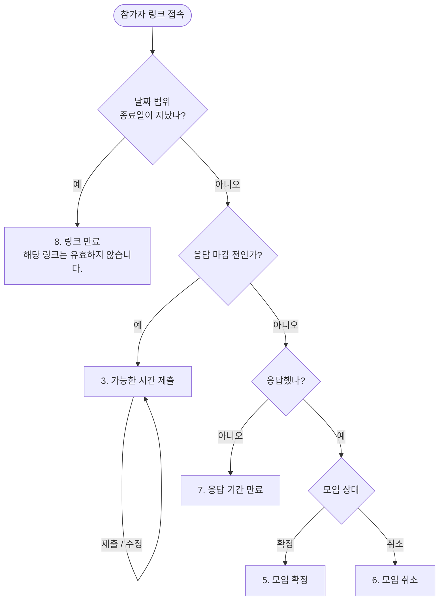
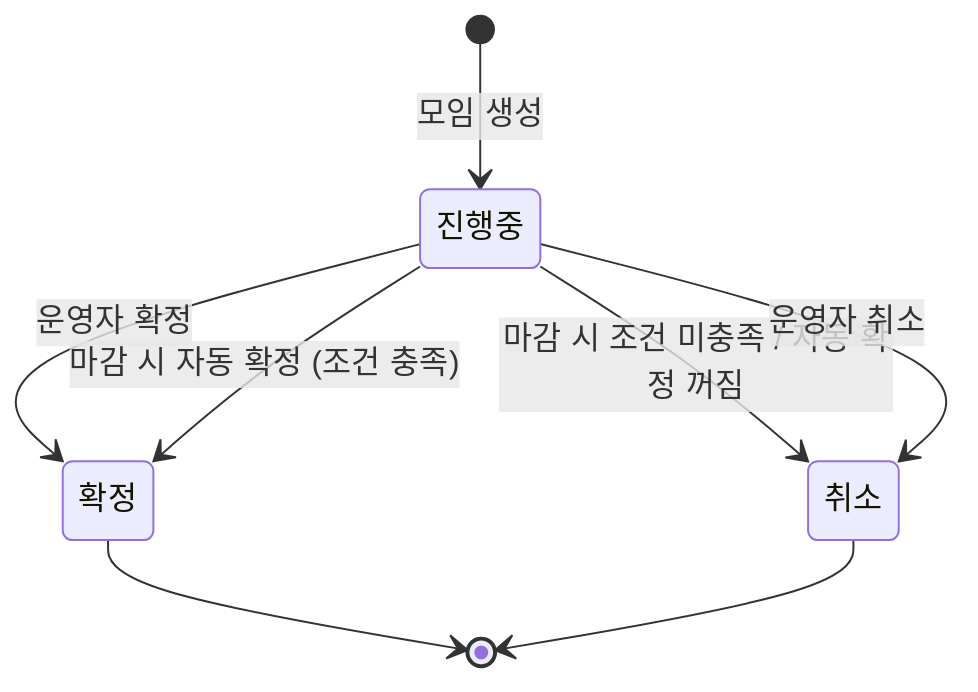

# 모여요 — 모임 일정 조율 서비스 요구사항

> 기준: [모여요 UI 시안](https://claude.ai/artifact/2gDk7u2b3FRQwQGewfuBBg) 최신 버전 (2026-11-20)
> 화면 예시 데이터(모임명, 이름, 날짜, 응답 수)는 시안용 샘플입니다.

---

## 1. 개요

운영자 1명이 날짜·시간 범위를 정해 모임을 만들고 참가자 링크를 공유합니다.
참가자(최대 10명)는 회원가입 없이 이름과 가능한 시간(30분 단위)을 제출합니다.
제출된 시간 중 겹치는 시간으로 모임을 **자동 확정**하거나 **운영자가 직접 확정**합니다.
확정할 시간이 없거나 확정되지 않은 채 마감되면 모임은 **취소**됩니다.

### 1.1 사용자

| 사용자 | 인원 | 설명 |
|---|---|---|
| 운영자 | 1명 | 모임 생성, 링크 공유, 응답 현황 확인, 확정·취소 |
| 참가자 | 모임당 최대 10명 | 회원가입 없이 참가자 링크로 접속해 이름과 가능한 시간 제출 |

### 1.2 모임 상태

| 상태 | 의미 | 배지 색 |
|---|---|---|
| 진행 중 | 응답을 받는 중 (응답 마감 전) | 초록 |
| 확정 | 일정이 정해짐 (자동 확정 또는 운영자 확정) | 파랑 |
| 취소 | 마감·최소 인원 미달·운영자 직접 취소 | 주황 |

- 모임 목록에서는 확정된 모임 시간이 지나면 '확정' 옆에 **'지난 모임'** 표시가 붙습니다.

---

## 2. 핵심 규칙

### 2.1 모임 만들기 (운영자)
| 항목 | 규칙 |
|---|---|
| 날짜 범위 | 달력에서 시작일·종료일 선택. **시작일 > 종료일 불가** (같은 날은 가능) |
| 하루 중 시간대 | 30분 단위 목록에서 선택. **시작 시간 ≥ 종료 시간 불가** |
| 과거 날짜 | 시작일과 응답 마감 달력에서 오늘 이전 날짜 선택 불가 |
| 모임 길이 | 30분 / 1시간 / 1.5시간 / 2시간 중 선택 |
| 최소 인원 | 1~10명. 이 인원이 모두 되는 시간이 없으면 모임 취소 |
| 응답 마감 | 날짜 + 시간 선택. **모임 시작일 전날(시작일 −1일)까지만** 선택 가능. 시간은 30분 단위 + 23:59 |
| 마감 때 자동 확정 | 스위치로 켜기/끄기 |

### 2.2 응답 (참가자)
- 회원가입 없이 **이름 + 가능한 시간**을 제출합니다.
- 시간은 **30분 단위 칸**을 **클릭(탭) 또는 드래그**로 선택합니다.
  - 빈 칸에서 드래그를 시작하면 지나가는 칸을 모두 선택, 선택된 칸에서 시작하면 모두 해제
  - 키보드(Tab 이동, Enter/Space 선택) 지원
- 모임당 참가자는 **최대 10명**입니다.
- 응답 마감 전까지는 같은 기기에서 응답을 수정할 수 있습니다.

### 2.3 마감과 서버 검증
- 응답 마감 시각이 지나면 **서버에서도 제출을 거절**합니다. (화면을 열어 둔 상태에서 보내도 거절)
- 서버는 제출 시 다음을 한 트랜잭션 안에서 확인합니다.
  - 모임 상태가 '진행 중'인지
  - 서버 시간 기준으로 응답 마감 전인지
  - 참가자 수가 10명 미만인지 (본인 수정은 예외)
  - 선택한 칸이 날짜·시간 범위 안이고 30분 단위인지
- 마감 처리는 접속 시점 확인 + 주기적 예약 작업(예: 1분 간격) 두 가지로 수행합니다.

### 2.4 확정과 취소
- **자동 확정** (스위치가 켜진 경우): 응답 마감 시각에 서버가 확정합니다.
  1. 모임 길이만큼 연속된 30분 칸 묶음을 후보로 만든다
  2. 후보마다 그 시간 전체가 가능한 참가자 수를 센다
  3. 최소 인원 이상인 후보 중 인원이 가장 많은 시간 → 동점이면 가장 이른 시간으로 확정
  4. 조건에 맞는 후보가 없으면 **취소**
- **운영자 확정**: 응답 현황 화면에서 추천 후보를 골라 확정합니다.
- **운영자 취소**: 응답 현황 화면에서 직접 취소합니다.
- 확정되지 않은 채 응답 마감이 지나면 모임은 취소됩니다.
- **자동 확정 스위치는 응답 마감 전까지만 변경**할 수 있습니다. (서버도 마감 뒤 변경 요청 거절)

### 2.5 참가자 링크 유효기간
- 참가자 링크는 **모임 생성 시 정한 날짜 범위의 종료일까지만 유효**합니다.
- 종료일 이후 접속하면 **"해당 링크는 유효하지 않습니다."** 안내를 보여줍니다.

### 2.6 캘린더 추가
- 확정된 모임은 **Google 캘린더 추가** 링크와 **.ics 파일 받기**(Apple·Outlook 등)를 제공합니다.

---

## 3. Flow

### 3.1 운영자 Flow



### 3.2 참가자 Flow (참가자 링크 접속)



### 3.3 모임 상태 Flow



---

## 4. IA (정보 구조)

```
모여요
├── 운영자
│   ├── 0. 모임 목록
│   │   ├── 상태 필터: 전체 / 진행 중 / 확정 / 취소
│   │   └── 모임 카드 → 상태별 화면 이동
│   ├── 1. 모임 만들기
│   ├── 2. 링크 공유
│   └── 4. 응답 현황과 확정 (진행 중)
│       ├── 4-A. 응답 현황 (확정)
│       └── 4-B. 응답 현황 (취소)
└── 참가자 (참가자 링크)
    ├── 3. 가능한 시간 제출          ← 응답 마감 전
    ├── 5. 모임 확정                 ← 응답함 + 확정
    ├── 6. 모임 취소                 ← 응답함 + 취소
    ├── 7. 응답 기간 만료            ← 응답 안 함 + 응답 마감 지남
    └── 8. 링크 만료                 ← 날짜 범위 종료일 지남
```

| ID | 화면명 | 사용자 | 진입 조건 |
|---|---|---|---|
| 0 | 모임 목록 | 운영자 | 서비스 첫 화면 |
| 1 | 모임 만들기 | 운영자 | 목록의 [새 모임] |
| 2 | 링크 공유 | 운영자 | 1번 [모임 시작], 목록의 진행 중 카드 |
| 3 | 가능한 시간 제출 | 참가자 | 참가자 링크 접속 + 응답 마감 전 |
| 4 | 응답 현황과 확정 | 운영자 | 2번 [모임 응답 현황] |
| 4-A | 응답 현황 (확정) | 운영자 | 4번에서 확정, 목록의 확정 카드 |
| 4-B | 응답 현황 (취소) | 운영자 | 4번에서 취소, 목록의 취소 카드 |
| 5 | 모임 확정 | 참가자 | 응답함 + 모임 확정 |
| 6 | 모임 취소 | 참가자 | 응답함 + 모임 취소 |
| 7 | 응답 기간 만료 | 참가자 | 응답 안 함 + 응답 마감 지남 |
| 8 | 링크 만료 | 참가자 | 날짜 범위 종료일 지남 |

---

## 5. 화면별 기능 정의

### 공통 UI 규칙
- 모바일 기준(390px) 화면
- 결과·안내 화면 상단 구성: **모임명(22px 굵게) → 상태 아이콘 원(48px) → 굵은 안내 문구(18px)**
  - 아이콘·원 색은 상태 배지 색을 따름 (확정·완료 파랑 / 취소 주황 / 만료 회색)
- 상태 배지는 헤더 오른쪽에 표시

---

### 0. 운영자 · 모임 목록

| 구분 | 내용 |
|---|---|
| 목적 | 운영자가 만든 모임을 상태별로 보고 관리 화면으로 이동 |
| 헤더 | 서비스명, [새 모임] 버튼 |
| 제목 | 내 모임 |
| 상태 필터 | 전체 / 진행 중 / 확정 / 취소 (각 개수 표시). 선택한 상태의 모임만 표시 |
| 모임 카드 | 모임명, 상태 배지, 날짜·시간, 응답 수 또는 참석 인원, 안내(마감까지 남은 시간, 결과 보기, 최소 인원 미달, 지난 모임 등) |
| 빈 상태 | "이 상태의 모임이 없어요" |
| 상태 설명 | 진행 중 / 확정 / 취소 / 지난 모임 의미 안내 |

| 동작 | 결과 |
|---|---|
| [새 모임] | 1. 모임 만들기 |
| 진행 중 카드 | 2. 링크 공유 |
| 확정 카드 | 4-A. 응답 현황 (확정) |
| 취소 카드 | 4-B. 응답 현황 (취소) |

---

### 1. 운영자 · 모임 만들기

| 구분 | 내용 |
|---|---|
| 목적 | 날짜·시간 범위와 확정 조건을 정해 모임 생성 |
| 헤더 | [<] 이전 화면(0. 모임 목록), 서비스명 |
| 제목 | 새 모임 만들기 / "범위를 정하면 참가자 링크가 만들어져요. 참가자는 최대 10명이에요." |
| 모임 이름 | 텍스트 입력 |
| 날짜 범위 | 시작일·종료일 버튼 → **달력** 팝업. 이전/다음 달 이동, 선택 기간 색 표시 |
| 하루 중 시간대 | 시작·종료 시간 버튼 → **30분 단위 시간 목록** 팝업. "하루 N칸" 안내 |
| 모임 길이 | 30분 / 1시간 / 1.5시간 / 2시간 선택 |
| 최소 인원 | [−] [+] 로 1~10명 |
| 응답 마감 | 날짜(달력) + 시간(목록) 선택 |
| 마감 때 자동 확정 | 스위치 |
| 하단 버튼 | [모임 생성] → 생성 후 [모임 시작] |

| 검증 | 처리 |
|---|---|
| 시작일 > 종료일 | 시작일 달력에서 종료일 이후 날짜 비활성, 종료일 달력에서 시작일 이전 날짜 비활성 |
| 시작 시간 ≥ 종료 시간 | 해당 시간 비활성 |
| 오늘 이전 날짜 | 시작일·응답 마감 달력에서 비활성 |
| 응답 마감 > 시작일 −1일 | 달력에서 비활성. 시작일 변경으로 규칙을 벗어나면 오류 문구 "응답 마감은 모임 시작 전날(M/D)까지만 고를 수 있어요. 다시 선택해 주세요." + [모임 생성] 비활성 |

| 동작 | 결과 |
|---|---|
| [모임 생성] | 모임 생성, 버튼이 [모임 시작]으로 바뀜 |
| [모임 시작] | 2. 링크 공유 |
| [<] | 0. 모임 목록 |

---

### 2. 운영자 · 링크 공유

| 구분 | 내용 |
|---|---|
| 목적 | 참가자 링크 공유, 모임 정보 확인, 자동 확정 설정 변경 |
| 헤더 | [<] 뒤로(1. 모임 만들기), 서비스명 |
| 상단 | 모임명 → 파란 체크 아이콘 → "모임이 만들어졌어요" → "참가자 링크를 단톡방이나 메일로 보내 주세요." |
| 참가자 링크 | 링크 주소 + [복사] (복사 후 "복사됨") |
| 모임 정보 | 모임명, 날짜, 시간대, 모임 길이·최소 인원, 응답 마감 |
| 마감 때 자동 확정 | 스위치. **응답 마감 전까지만 변경 가능** |
| 하단 버튼 | [참가자 화면 보기], [모임 응답 현황] |

| 상태 | 자동 확정 스위치 |
|---|---|
| 응답 마감 전 | 켜기/끄기 가능. "응답 마감(11/22 23:59) 전까지 바꿀 수 있어요" |
| 응답 마감 후 | 비활성(흐린 색). "응답 마감이 지나 바꿀 수 없어요" |

| 동작 | 결과 |
|---|---|
| [참가자 화면 보기] | 3. 가능한 시간 제출 (운영자 미리보기) |
| [모임 응답 현황] | 4. 응답 현황과 확정 |

---

### 3. 참가자 · 가능한 시간 제출

| 구분 | 내용 |
|---|---|
| 진입 조건 | 참가자 링크 접속 + 응답 마감 전 + 날짜 범위 종료일 전 |
| 헤더 | 서비스명, 마감까지 남은 시간 |
| 상단 | 모임명, "모임 길이 · 응답 N/10명 · 마감 일시" |
| 이름 | 텍스트 입력 |
| 시간 선택 | 날짜(열) × 30분 칸(행) 표. **클릭 또는 드래그**로 가능/불가 선택 |
| 범례·합계 | 가능 / 불가, "선택 N칸 (N시간)" |
| 제출 완료 안내 | "제출했어요. 마감 전까지는 이 기기에서 다시 고칠 수 있어요." |
| 하단 버튼 | [제출하기] → 제출 후 [수정 내용 다시 제출] |

| 동작 | 결과 |
|---|---|
| 칸 클릭 | 해당 칸 선택/해제 |
| 드래그 | 시작 칸 기준으로 지나간 칸 일괄 선택 또는 해제 |
| [제출하기] | 서버 검증(2.3) 후 저장, 완료 안내 표시 |

---

### 4. 운영자 · 응답 현황과 확정 (진행 중)

| 구분 | 내용 |
|---|---|
| 헤더 | [<] 모임 목록, 서비스명·운영자, 상태 배지 '진행 중' |
| 요약 | 응답 N/10명, 마감까지 남은 시간, 최소 인원 |
| 히트맵 | 시간대별 가능 인원 (진할수록 많이 겹침). 선택한 후보 시간은 주황 테두리 |
| 추천 후보 | 모임 길이만큼 연속으로 최소 인원 이상 가능한 시간, 인원 많은 순. 일시·인원·이름 |
| 자동 확정 안내 | 자동 확정이 켜져 있을 때 "이대로 마감되면 OO로 확정돼요. 최소 인원이 모두 되는 시간이 없으면 모임은 취소돼요." |
| 하단 버튼 | [선택 후보로 확정], [모임 취소하기] |

| 동작 | 결과 |
|---|---|
| 후보 선택 | 히트맵에 해당 시간 표시, 확정 버튼 문구 변경 |
| [선택 후보로 확정] | 모임 확정 → 4-A |
| [모임 취소하기] | 모임 취소 → 4-B |

---

### 4-A. 운영자 · 응답 현황 (확정)

| 구분 | 내용 |
|---|---|
| 헤더 | [<] 모임 목록, 상태 배지 '확정' |
| 상단 | 모임명 → 파란 체크 아이콘 → "모임이 확정됐어요" |
| 확정 일시 | 날짜·시간, 모임 길이, 참석 인원 |
| 요약 | 응답 N/10명, 참석 N명, 최소 인원 |
| 참석하는 사람 | 참석자 이름 목록, 이 시간에 안 되는 사람 |
| 히트맵 | 읽기 전용. 확정 시간 주황 테두리 |
| 버튼 | 없음 (확정·취소 불가) |

---

### 4-B. 운영자 · 응답 현황 (취소)

| 구분 | 내용 |
|---|---|
| 헤더 | [<] 모임 목록, 상태 배지 '취소' |
| 상단 | 모임명 → 주황 달력 X 아이콘 → "모임이 취소됐어요" |
| 요약 | 응답 N/10명, 최대 겹침 인원, 최소 인원 |
| 상세 | 취소 사유, 응답 마감, 응답한 사람 |
| 히트맵 | 읽기 전용 |
| 버튼 | 없음 |

---

### 5. 참가자 · 모임 확정 (응답함 → 확정)

| 구분 | 내용 |
|---|---|
| 진입 조건 | 응답한 참가자 + 모임 확정 |
| 헤더 | 상태 배지 '확정' |
| 상단 | 모임명 → 파란 체크 아이콘 → "모임이 확정됐어요" |
| 확정 일시 | 날짜·시간·모임 길이, 확정 방식(예: 운영자 확정 시각) |
| 참석 인원 | 참석 N명 / 응답 N명, 참석자 이름, 이 시간에 안 되는 사람 |
| 캘린더 추가 | [Google 캘린더에 추가], [캘린더 파일 받기 (.ics)] |
| 안내 | 응답이 마감되어 더 이상 제출·수정할 수 없음 |

---

### 6. 참가자 · 모임 취소 (응답함 → 취소)

| 구분 | 내용 |
|---|---|
| 진입 조건 | 응답한 참가자 + 모임 취소 |
| 헤더 | 상태 배지 '취소' |
| 상단 | 모임명 → 주황 달력 X 아이콘 → "모임이 취소됐어요" |
| 상세 | 응답한 사람 수, 가장 많이 겹친 시간, 취소 사유 |
| 마감 뒤 제출 시도 | 이름·[제출] 비활성 "응답이 마감됐어요" + 오류 안내 "제출하지 못했어요. 이미 마감된 모임이에요." |

---

### 7. 참가자 · 응답 기간 만료 (응답 안 함)

| 구분 | 내용 |
|---|---|
| 진입 조건 | 응답하지 않은 참가자 + 응답 마감 지남 |
| 헤더 | 회색 배지 |
| 상단 | 모임명 → 회색 시계 아이콘 → "응답 기간이 만료됐어요" |
| 표시하지 않는 정보 | 확정 여부, 모임 날짜·시간, 참석자, 새 모임 만들기 버튼 |

---

### 8. 참가자 · 링크 만료 (날짜 범위 종료일 이후)

| 구분 | 내용 |
|---|---|
| 진입 조건 | 날짜 범위 종료일이 지난 뒤 참가자 링크 접속 (응답·확정 여부와 관계없이 우선 적용) |
| 상단 | 회색 끊어진 링크 아이콘 → **"해당 링크는 유효하지 않습니다."** |
| 표시하지 않는 정보 | 모임명, 날짜, 참석자 등 모임 정보 |
| 서버 | 종료일 이후 참가자 링크 요청 거절 |

---

## 6. 미결 사항

| 항목 | 내용 |
|---|---|
| 운영자 식별 방법 | 회원가입 없이 운영자 화면(0·1·2·4번)을 운영자만 볼 수 있게 할 방법 미정 (예: 운영자 로그인, 운영자 비밀번호, 별도 관리자 주소) |
| 예시 데이터 요일 | 시안의 일부 날짜 요일이 실제 2026년 달력과 하루씩 다름 (예: 11/24는 화요일). 1번 달력만 실제 요일로 계산 |
| 7번 배지 문구 | 7번 헤더 배지가 '지난 모임'으로 표시됨. "응답 기간 만료" 문구와 맞출지 미정 |
| 0번 '지난 모임' 표시 | 목록의 '지난 모임' 표시 기준(확정된 모임 시간이 지나면)을 유지할지 확인 필요 |
